# From a collected price to the published index: a walkthrough

This guide follows **one month of prices** through the system, screen by screen:
which button to press, who presses it, and **what to do when a price is wrong** at
each step. The screenshots are from the Uganda system (June 2026, Arua), taken on a
copy of the database so that nothing real was changed.

```text
 COLLECTION                              VALIDATION (one per centre and month)             INDEX
 ─────────────────────────────────────   ───────────────────────────────────────────────   ─────────────────
 1 Create      2 Approve   3 Collect     5 Validate   6 Review      7 Validate  8 Impute     11 Compute the
   question-     (Draft →    prices        (checks)     flagged       Inliers     9 Finalize     index
   naires        Price       4 Submit                   prices                    10 Promote   12 Check the
                 Survey)       & check                                                         dashboards
```

| Who | Does |
|---|---|
| **Supervisor** | creates and assigns questionnaires, approves them, checks submitted prices, sends them back or on to validation |
| **Collector** | prices the items (mobile app or web), submits |
| **Senior statistician** | runs the validation, accepts / rejects flagged prices, imputes, finalizes, promotes, computes the index |

---

## Part 1 · Collection (the questionnaire)

A **questionnaire** is one outlet's list of items for one month. It moves through
**Draft → Price Survey → Standardization → Validation → Done**; the bar at the top
right of the questionnaire always shows where it is.

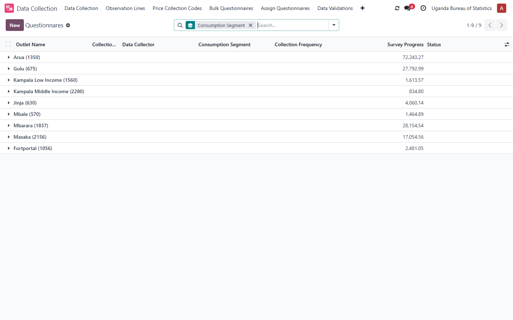

### Step 1 · Create the month's questionnaires (supervisor)

*Data Collection → Bulk Questionnaires.* Choose the **consumption segment** (centre)
and the **collection date**, then **Create Questionnaires**. One questionnaire is made
per outlet, with a line for every active item of that outlet. Items priced twice a
month get their own questionnaire.

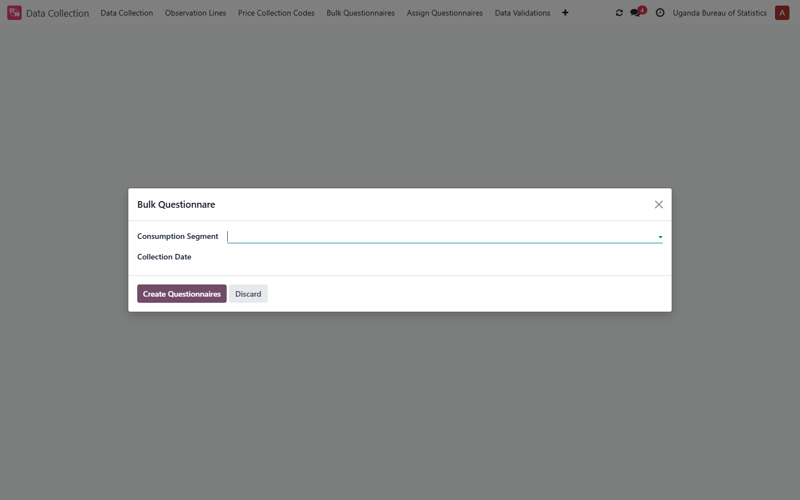

Then *Data Collection → Assign Questionnaires* to give them a **data collector** and a
**supervisor**.

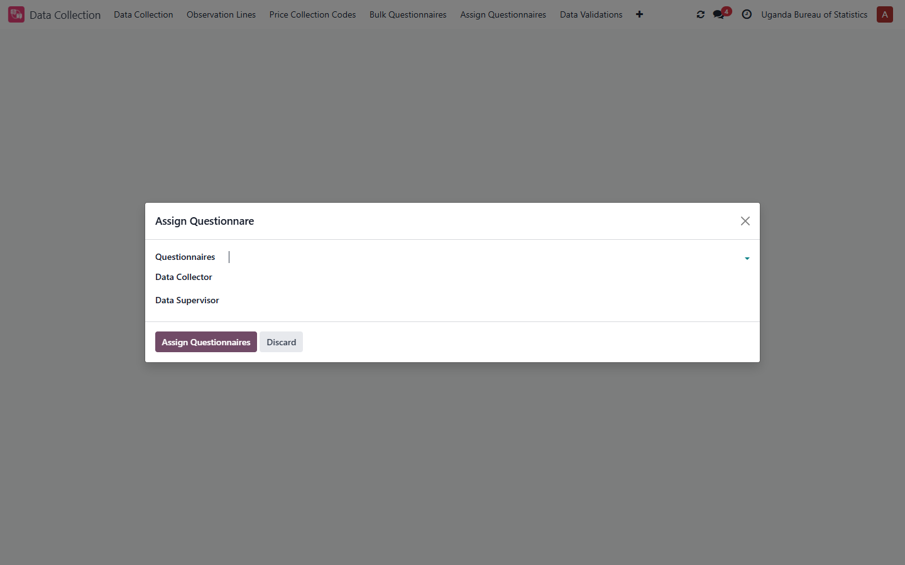

> Kenya, Tanzania and Zanzibar have their own versions of these two screens (by zone,
> region or collection centre); the steps are the same.

### Step 2 · Approve (supervisor) · Draft → Price Survey

Open the questionnaire and press **Approve**. It needs a collector and a supervisor.
The questionnaire now appears on the collector's phone. (**Cancel** is also here, for
a questionnaire that should not be collected.)

Many at once: in the questionnaire list, filter **To approve (draft)**, tick the
questionnaires (or the box at the top for all) and press **Approve selected**.

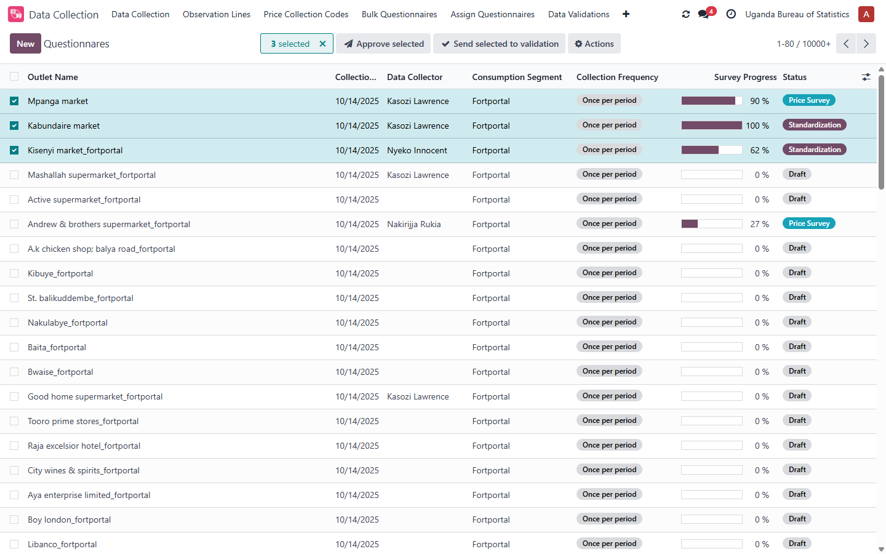

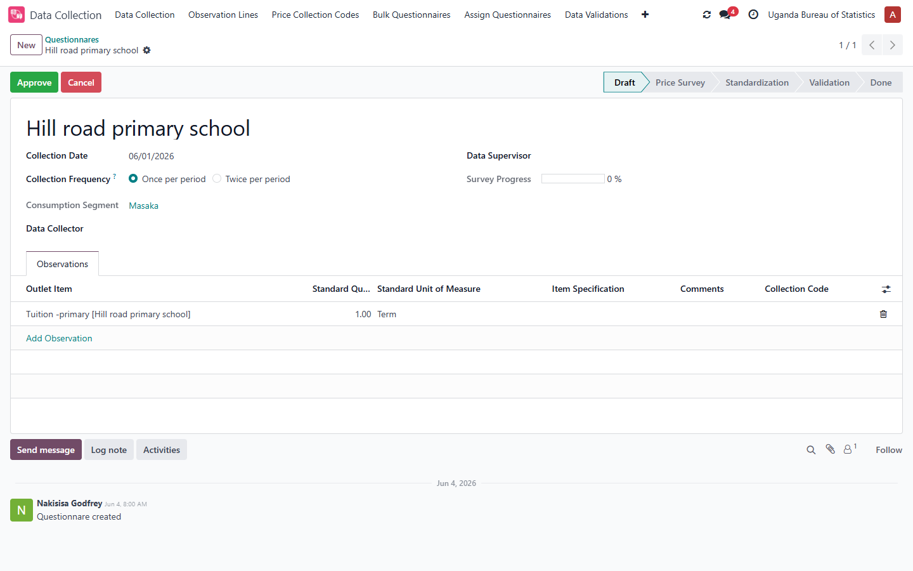

### Step 3 · Collect the prices (collector) · Price Survey

On the phone (or on the web, in the questionnaire's lines), each item gets a
**price**, the **quantity** and **unit** it was priced for, and a **collection code**
when there is no price (**T** temporarily missing, **P** permanently missing) or
something to explain (season, rise / drop confirmed). Items priced twice a month get
one price per visit.

**Wrong price at this step?** The system checks each price **as it is typed**: the
*Range Check* badge compares it with the outlet's last price (± 30%) and shows
**In range**, **Above range** or **Below range**. It never blocks: if the price is
right, keep it and add a remark; if not, correct it there and then.

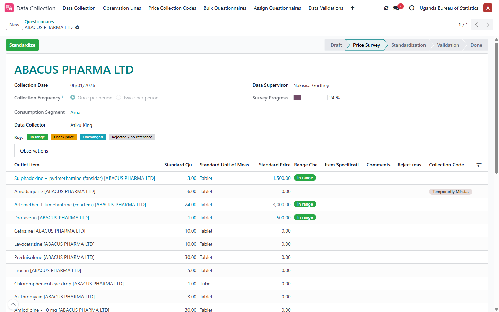

Inside a line you see each visit's price, the price converted to the standard
quantity, and the expected range:

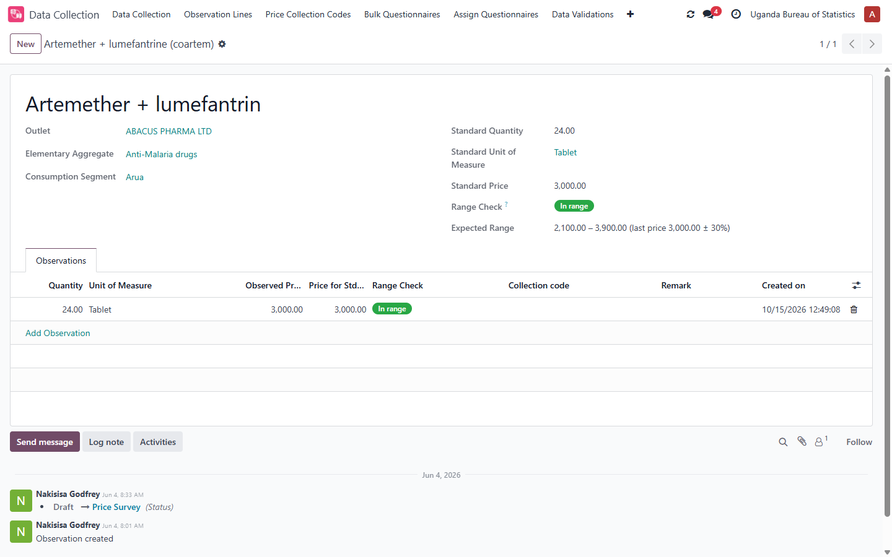

### Step 4 · Submit, then check (collector → supervisor) · Price Survey → Standardization

- The **collector** submits (on the web: **Submit for checking**).
- The questionnaire then shows a yellow banner, *Waiting for the supervisor*. The
  supervisor's list filter for these is **Waiting to be checked**.

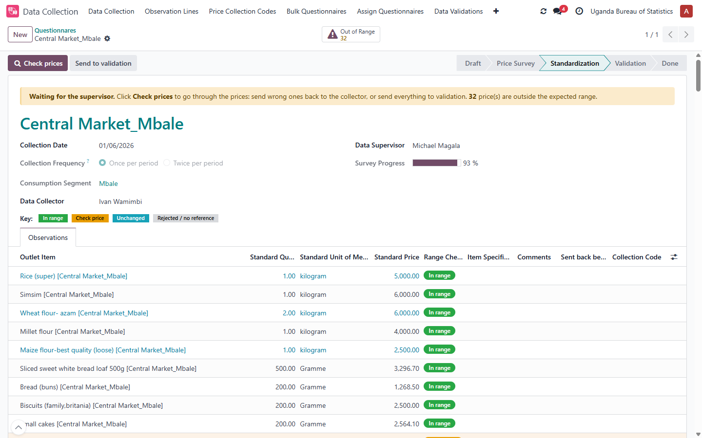

The supervisor presses **Check prices**. One screen shows every price next to the
**last price**, the **change** and the **range check**, problems first:

- prices **outside the expected range** are already ticked to be sent back;
- items with **neither a price nor a code** are ticked too (they were not collected);
- everything else is unticked.

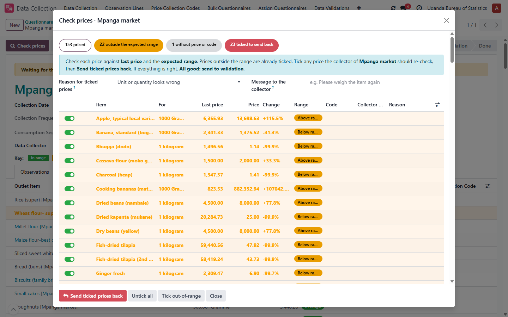

Then:

| You decide | Press | What happens |
|---|---|---|
| Some prices are wrong | adjust the ticks, pick a **reason** (e.g. *Unit or quantity looks wrong*; a line can have its own), optionally a message, then **Send ticked prices back** | the questionnaire goes back to the collector (**Price Survey**) with a red banner listing what to re-check; the lines are marked in red with their reason, and the collector's phone shows the same summary |
| Everything is right | untick (or **Untick all**), then **All good: send to validation** | the prices go to this centre's **Data Validation** for the month |

In the example (Fort Portal, October 2026) the screen shows 22 prices outside the
range at once, e.g. charcoal at 1.41 against 1,347 last time: clearly a unit error to
send back before it reaches validation.

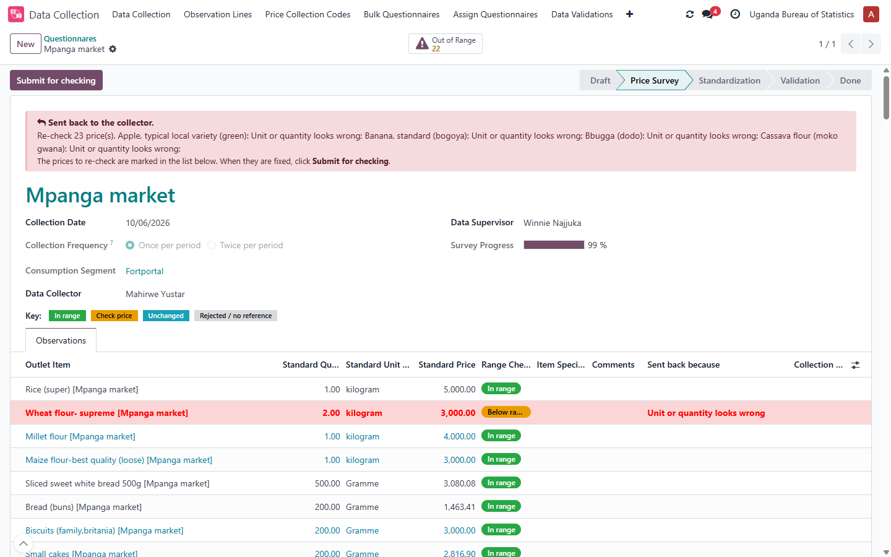

Shortcuts: **Send to validation** on the questionnaire skips the check screen; in
the list, **Send selected to validation** does it for many questionnaires at once.
Already sent by mistake? While the validation is still in **Draft**,
**Take back from validation** brings the questionnaire back.

> Kenya has an extra *Review* step before standardization; there **Check prices**
> works the same, and *All good* approves the questionnaire for standardization.

---

## Part 2 · Validation (one per centre and month)

*Data Collection → Data Validations.* All submitted questionnaires of a centre and
month land in **one validation** (e.g. *Arua/June/2026*). It has four steps, shown in
the bar at the top right and explained in the blue banner, which always says
**what to do next**. Only the next button is highlighted.

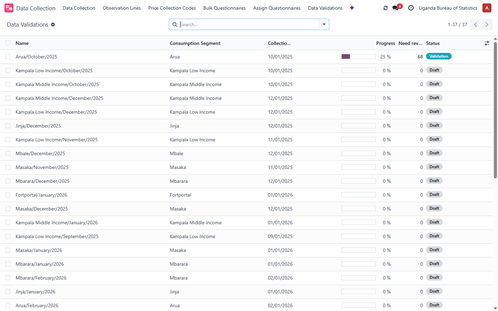

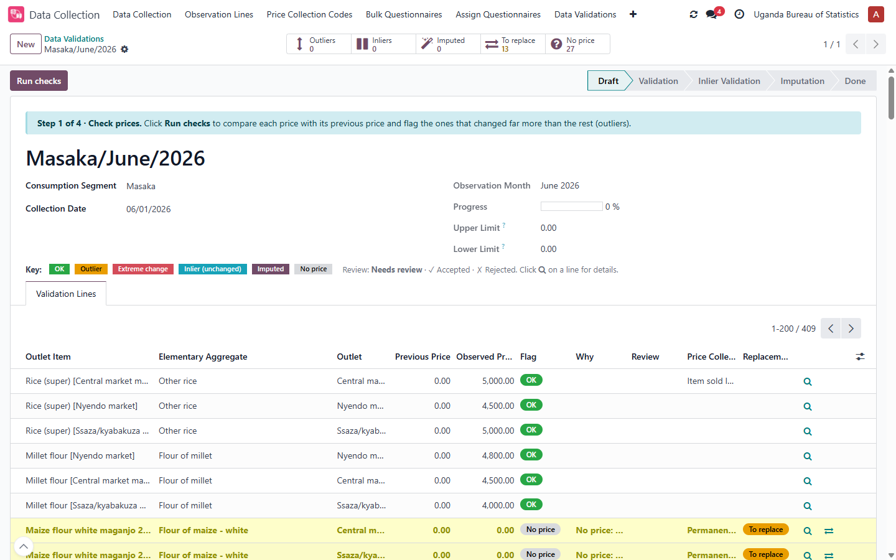

**Every price gets one flag, with the reason in words** (column *Why*):

| Flag | Meaning |
|---|---|
| **OK** | normal price change |
| **Outlier** | change outside the limits worked out from this month's changes |
| **Extreme change** | among the very largest / smallest changes this month |
| **Inlier** | exactly the same price 12 months in a row (was it really collected?) |
| **Imputed** | no usable price; filled in from similar items |
| **No price** | missing, temporarily missing, or rejected (will be imputed) |

### Step 5 · Run checks (statistician) · Draft → Validation  *(step 1 of 4)*

Press **Run checks**. The system computes each price's change against last month and
flags outliers and extreme changes.

### Step 6 · Review the flagged prices *(step 2 of 4)*

The banner says how many need a decision. Press **Review flagged prices**: a list of
just those prices.

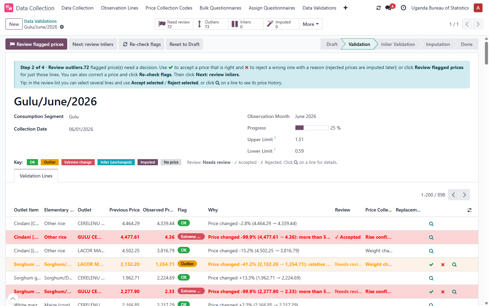

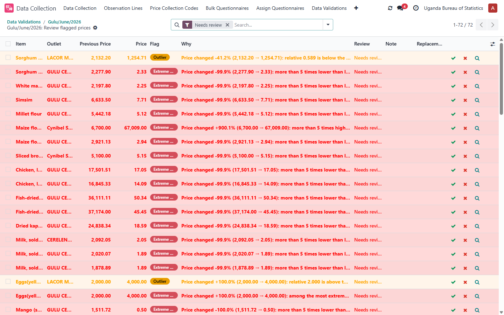

Every flagged row has two buttons: a green **✓ (accept)** and a red **✗ (reject)**.
✓ takes one click; ✗ opens a short dialog with a reason already picked (*Unit or
quantity error*, *Typing error*, *Wrong item*, *Not really collected*…). The
magnifier 🔍 shows the details and the last 12 months of prices.

| Decision | When | What happens |
|---|---|---|
| **Accept price** | the price is right (e.g. a real price rise) | it is used as collected |
| **Reject price** | the price is wrong (typing or unit error) | **a note is required**; the collected price is kept on file, and the line is treated as missing and **imputed** in step 8 |
| type the correct price, then **Re-check flags** | you know the right value (an obvious typing error) | the change is written in the note automatically and the flags are re-computed |

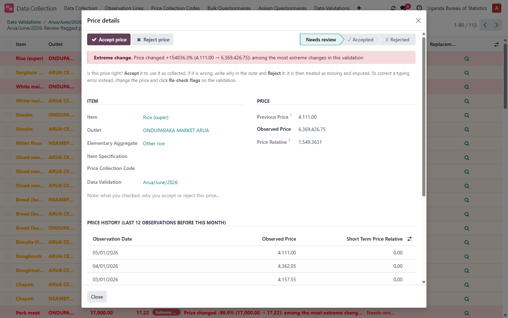

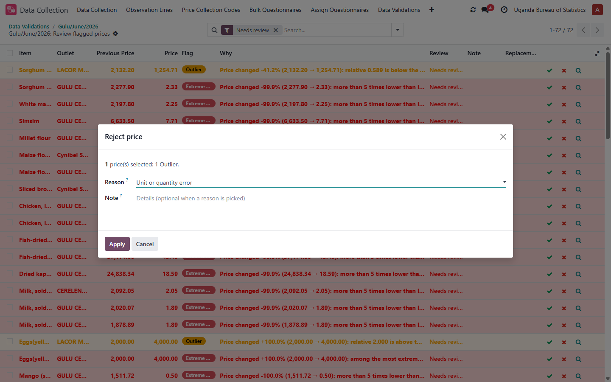

Many lines? In the list, filter or group them, tick the box at the top to select all,
then **Accept selected** / **Reject selected**. Every decision records who and when,
and can be undone with **Undo decision** until the validation is finished.

In the example, Arua's June data has many **unit errors** (e.g. rice at 6,369,426
against 4,111 last month): those were rejected with the note *"Unit error: price is
for a bag / wrong quantity"*, and the few genuine changes accepted.

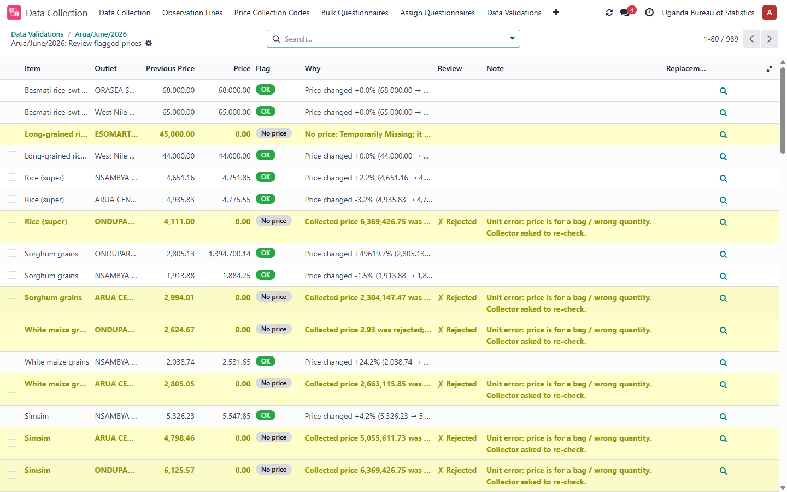

When nothing needs a decision, press **Next: review inliers**.

### Step 7 · Review inliers *(step 3 of 4)*

Inliers are prices that did not change for **12 months in a row**. Check they were
really collected (not copied from last month). Accept or reject them the same way.
An accepted inlier is **not flagged again for 6 months**.

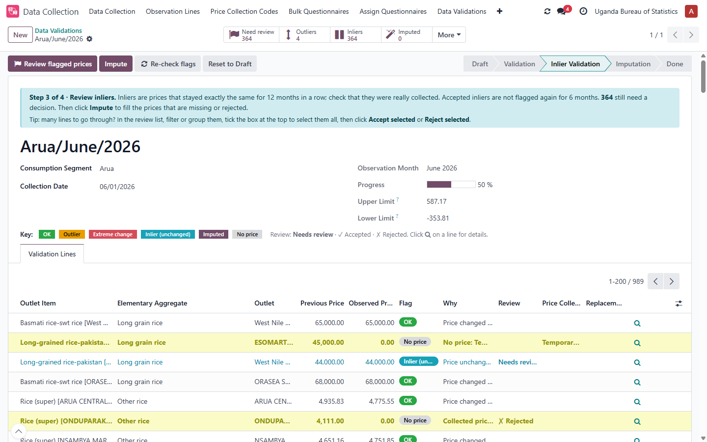

Then press **Impute missing prices**.

### Step 8 · Impute *(step 4 of 4)*

**Impute missing prices** first shows a preview: how many prices are missing and why (temporarily
missing, permanently missing, not collected). Confirm to fill them in.

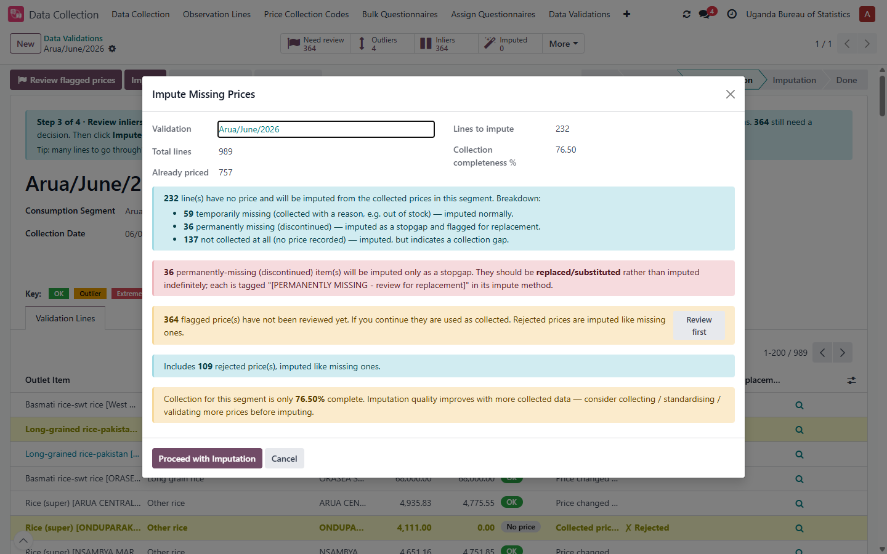

Each missing or rejected price is estimated from the price change of, in order: the
same item in other outlets → the same elementary aggregate → micro class → sub class →
… → another centre. The *Why* column says which one was used.

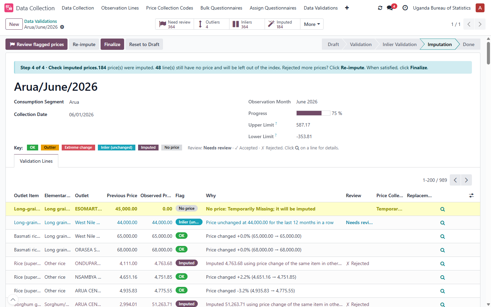

- A few lines may stay **without a price** (no similar item had prices). The banner
  says how many; they are left out of the index.
- Rejected more prices after imputing? Press **Re-impute**.
- A **permanently missing (P)** item should be **replaced**: a **To replace** button
  appears on the validation; see *Replacements* in
  [the change note](../changes/replacements-upload-map-offline.md).

### Step 9 · Finalize · Imputation → Done

Press **Finalize** when you are satisfied. The validation is closed.

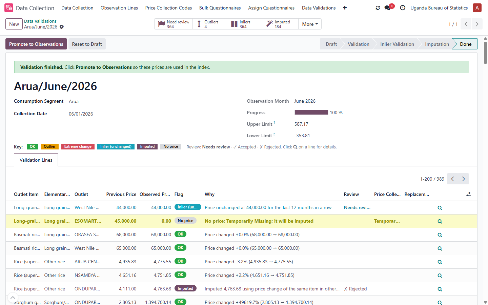

### Step 10 · Promote to Observations

Press **Promote to Observations**. This copies the validated (and imputed) prices
into the price history the index is computed from. The screen lists every price:
**New** (no price on file for this month yet) or **Conflict** (a price is already on
file, e.g. from an upload). Conflicts default to **Use Validated**; switch a row to
**Keep Existing** to leave that one untouched. Then **Promote**.

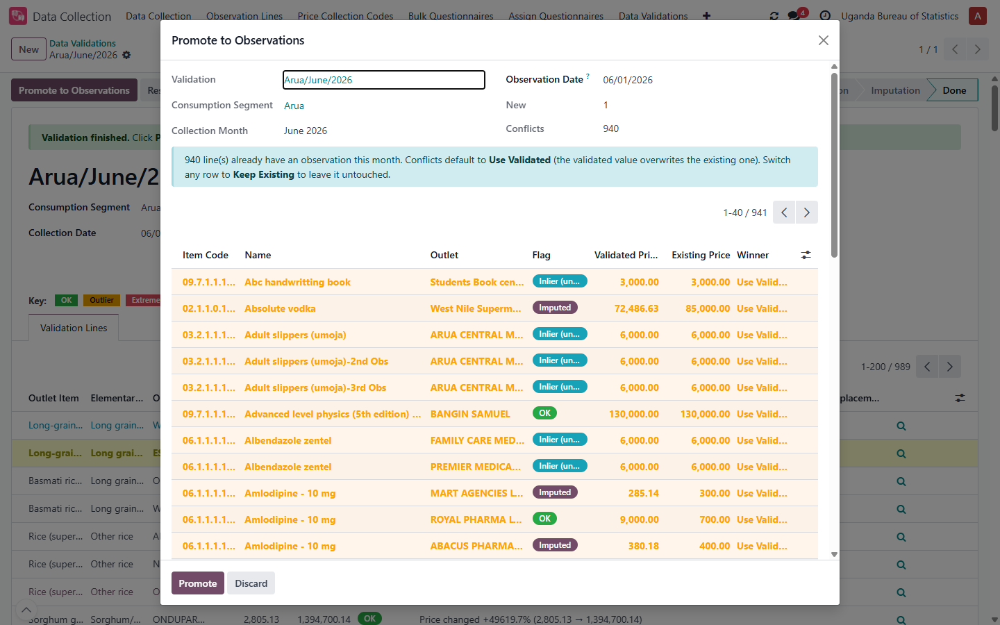

Imputed prices stay marked as imputed in the history and in the Excel export.

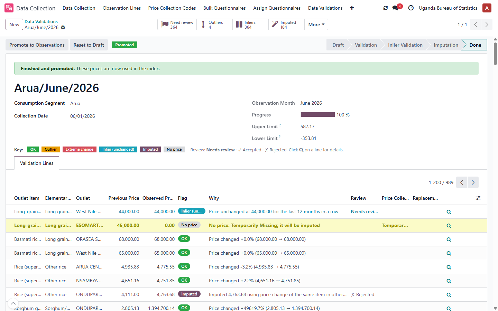

**Wrong price found after promotion?** Change it in *Outlets → Price Data* (it is
then no longer marked imputed), or **Reset to Draft** the validation, fix it, and go
through the steps and **Promote** again (conflicts → *Use Validated*). Then recompute
the index (step 11).

---

## Part 3 · The index

### Step 11 · Compute the index (statistician)

*Indices → Computations*, **in this order**, each with **New → Start Update**:

1. **Update EA Indices**
2. **Update Basket COICOP Indices**
3. **Update Basket Indices**
4. **Update National Indices**

Each waits for the previous one; if one is still running, the system says so and
offers **Release running job & retry** when a job is stuck.

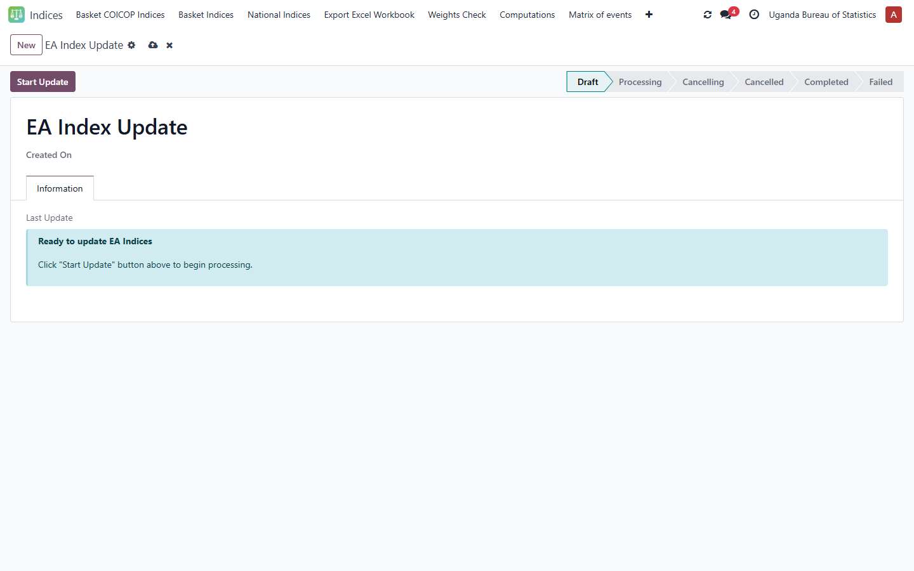

### Step 12 · Check the result

- **Operations dashboard**: how far the month has got (issued → submitted →
  validated → promoted → in the index), per centre, and what is still missing.
- **CPI dashboard**: annual and monthly inflation, what drove it, divisions, movers.
- **Price Review Reports** (Data Collection menu): outliers & inliers, imputed and
  rejected prices, across validations.

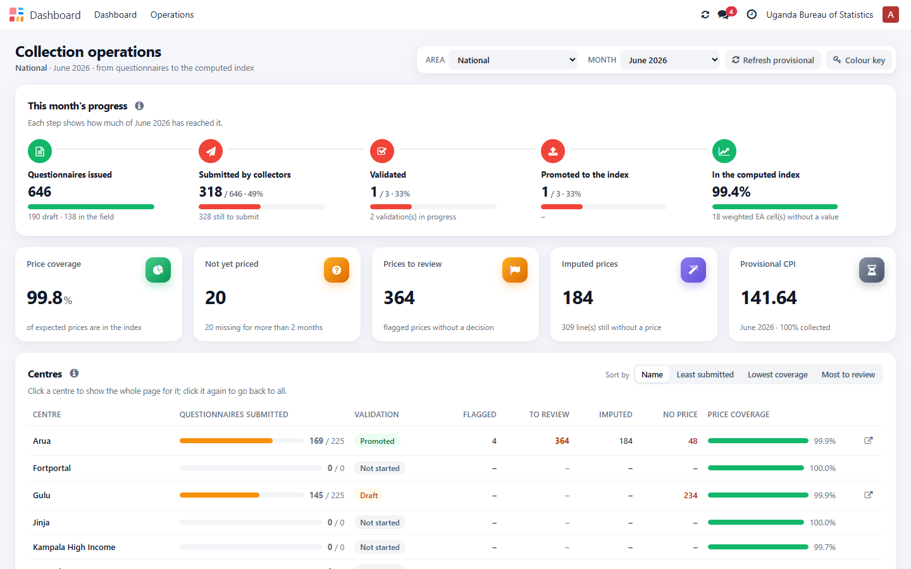

---

## Quick reference: which button, when

| Where you are | Status | Press | Who |
|---|---|---|---|
| Questionnaire | Draft | **Approve** (list: **Approve selected**), or **Cancel** | Supervisor |
| Questionnaire | Price Survey | enter prices, then **Submit for checking** | Collector |
| Questionnaire | Standardization | **Check prices** → *Send ticked prices back* or *All good: send to validation* (list: **Send selected to validation**) | Supervisor |
| Questionnaire | Validation | (**Take back from validation**, only while its validation is in Draft) | Supervisor |
| Validation | Draft | **Run checks** | Statistician |
| Validation | Validation | ✓ / ✗ on each flagged price (or **Review flagged prices**, select, *Accept / Reject selected*) → **Next: review inliers** | Statistician |
| Validation | Inlier Validation | ✓ / ✗ on inliers → **Impute missing prices** | Statistician |
| Validation | Imputation | (**Re-impute**) → **Finalize** | Statistician |
| Validation | Done | **Promote to Observations** → **Promote** | Statistician |
| Indices → Computations | – | EA → Basket COICOP → Basket → National, each **Start Update** | Statistician |

---

## What I noticed while writing this (worth deciding)

1. **Fixed: the outlier limits could be blown open by the errors themselves.** The
   limits are computed from the month's own price changes; in Arua June 2026 the unit
   errors pushed the upper limit to **587× the previous price**, so a sorghum price
   going from 2,805 to 1,394,700 was flagged **OK**. Now any price more than **5×** (or
   under **⅕**) of last month's is always an *extreme change*, with the reason "probably
   a unit or typing error", and is kept out of the limit calculation. On Arua the limits
   became 0.39–1.91 and no impossible price passes; on Gulu the number of flags stayed
   about the same. The 5 is a setting (`hcpi_data_collection.sanity_ratio`; 0 = off).
2. **Done: rejecting a questionnaire was roundabout** (a list, reasons typed per line,
   then a hidden *Actions → Reject Observations*, and the reasons never reached the
   collector's phone). Now: **Check prices** (step 4). Original note: **Reject** opens a list, you type
   reasons per line, then use the hidden *Actions → Reject Observations*. A simple
   dialog ("reason" + pick the lines) would be clearer. (A reject dialog exists in the
   code but nothing opens it.)
3. **Done: two different "Validate" buttons.** Renamed *Send to validation* and *Run
   checks*; also *Submit for checking*, *Next: review inliers*, *Impute missing prices*.
   Original note: *Validate Prices* (questionnaire: send to
   validation) and *Validate* (validation: run the checks) sound the same. Suggested
   names: **Send to validation** and **Run checks**.
4. **Inlier decisions are many.** Arua had 364 inliers to decide on in one month. The
   bulk *Accept selected* handles it, but a rule (e.g. accept automatically when the
   collector confirmed "unchanged") could reduce the work.
5. **The index computations are four separate screens** to run in order. A single
   **Compute index for <month>** button that runs the four in sequence would avoid
   mistakes.

Tell me which of these to change.
